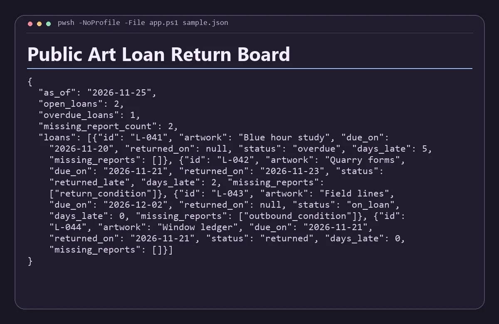

# Public Art Loan Return Board

Track public art loans by due date and return status, and flag missing outbound or return condition reports.



## Run

Install PowerShell 7 or newer. Run these commands from the repository root.

```sh
pwsh -NoProfile -File app.ps1 sample.json
```

Replace `sample.json` with a JSON file following the same structure. The app prints a JSON report to standard output.

Use yyyy-MM-dd dates, unique loan IDs, and boolean flags for the condition reports. Leave returned_on null while the artwork is on loan. An open loan becomes overdue the day after its due date. Return paperwork is required in the report once the artwork has been returned.

## Verify

Run `python check.py` with Python 3.11 or newer after the build step when applicable. The check verifies the bundled scenario and confirms that an invalid input returns an error.
